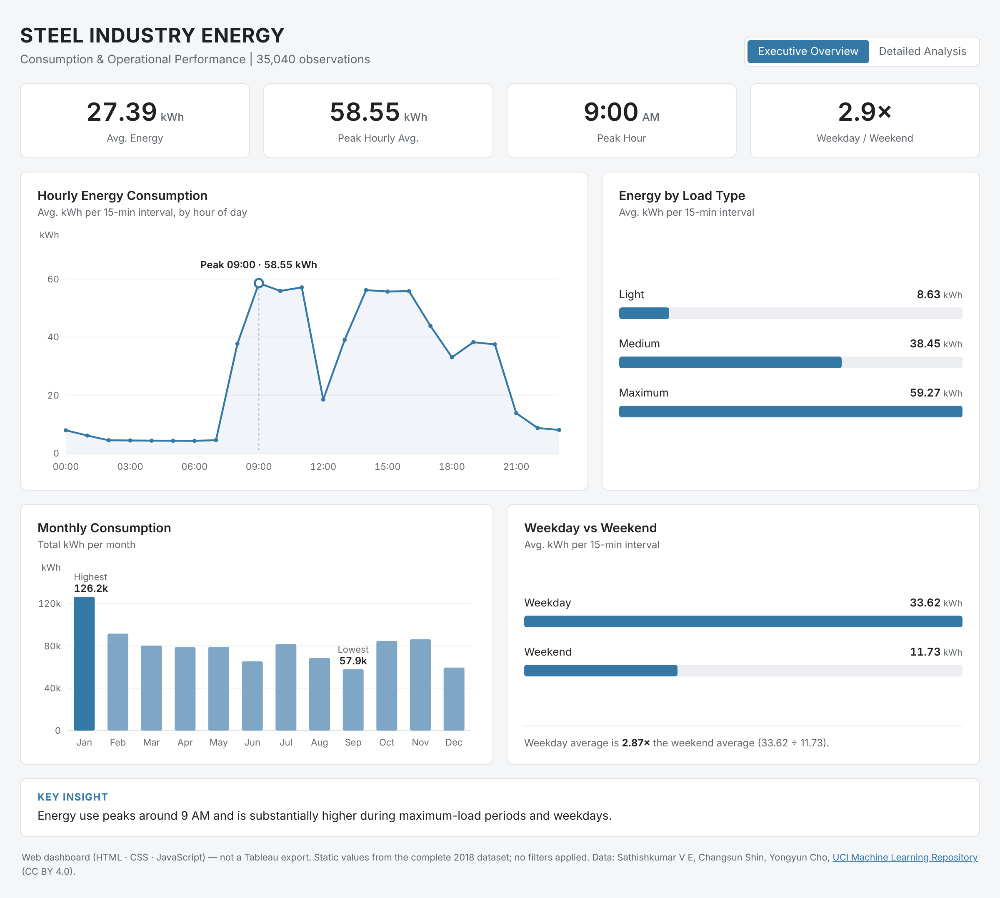

# Steel Industry Energy — Web Dashboard

A two-view web dashboard (HTML · CSS · JavaScript, no libraries) presenting the validated results of the Steel Industry Energy Consumption Analysis.

> This is a **web dashboard**, not a Tableau export. The original Tableau workbook (`../tableau/Steel_Industry_Energy_Analysis.twbx`) is kept unchanged as the record of the Tableau work, including the interval-level scatter plots with trend lines.



## Views

| View | Contents |
|---|---|
| **Executive Overview** | 4 KPI cards · Hourly Energy Consumption · Energy by Load Type · Monthly Consumption (totals) · Weekday vs Weekend · Key Insight |
| **Detailed Analysis** — Energy Relationships | r and R² for reactive power, CO₂ and power factor · Energy vs Reactive Power · Energy vs CO₂ · Frequency vs Energy Impact by Load Type |

Switch views with the tabs at the top right. Hover any bar, point or segment for its exact value. Direct link to the second view: `index.html#detail`.

## How to run

**Locally:** double-click `index.html`. No server, build step or internet connection needed.

**GitHub Pages:**
1. Push the repository to GitHub.
2. Repository → *Settings* → *Pages* → *Build and deployment* → *Source: Deploy from a branch*.
3. Choose branch `main` and folder **`/docs`**, then *Save*.
4. After a minute or two the dashboard is live at `https://<username>.github.io/steel-industry-energy-analysis/`.

## Files

```
docs/
├── index.html          page structure (both views)
├── styles.css          layout, colour palette, responsive rules
├── script.js           draws every chart from the data file (SVG + HTML)
├── data/data.js        validated summary values
├── screenshots/        renders of this page in headless Chromium
└── README.md
```

## Data integrity

- **Averages vs totals.** The hourly, load-type and weekday/weekend charts show *average kWh per 15-minute interval* (`AVG`); the monthly chart shows *total kWh per month* (`SUM`). Each card states its unit. The 12 monthly totals add up to 959,636.71 kWh.
- **r vs R².** The large numbers on the Detailed Analysis cards are Pearson correlation coefficients (r, from `CORR()` over all 35,040 intervals). R², the share of variance explained by a linear fit, is shown underneath and was computed from the unrounded r.
- **Static values.** The dashboard has no filters; KPIs describe the full 2018 dataset. The only value derived in the browser is the weekday/weekend ratio (33.62 ÷ 11.73 = 2.87, shown as 2.9×).
- **Load-type averages.** The two Detailed Analysis charts plot three points each (one per load type). Interval-level scatter plots remain in the Tableau workbook.
- **Verification.** `../scripts/verify_metrics.py` recomputes all 79 dashboard values from the data export inside the Tableau workbook and compares them with `data/data.js`. The queries in `../sql/02_exploratory_analysis.sql` and `../sql/03_dashboard_supporting_metrics.sql` reproduce them in BigQuery.
- Correlations describe associations, not causes.

## Data source

Sathishkumar V E, Changsun Shin, and Yongyun Cho. **Steel Industry Energy Consumption** [Dataset]. UCI Machine Learning Repository, 2018. https://doi.org/10.24432/C52G8C — CC BY 4.0.
